<!-- mcp-name: io.github.threx-code/cordon -->
<picture>
  <source media="(prefers-color-scheme: dark)" srcset="docs/assets/logo-dark.svg">
  
</picture>

**A supply-chain security scanner that reads every dependency before it runs.**

[](https://github.com/Threx-code/cordon/actions/workflows/ci.yml)
[](https://pypi.org/project/cordon-scanner/)
[](https://pypi.org/project/cordon-scanner/)
[](https://github.com/Threx-code/cordon/blob/v0.6.0/pyproject.toml)
[](https://github.com/Threx-code/cordon/blob/v0.6.0/LICENSE)
[](https://github.com/Threx-code/cordon/blob/v0.6.0/docs/05-COVERAGE-MATRIX.md)
[](https://github.com/Threx-code/cordon/blob/v0.6.0/docs/07-ECOSYSTEMS.md)

Attackers stopped breaking in and started being installed: a typosquatted package, a release
pushed with a stolen token, a workflow that prints its secrets, an MCP server that tells your
coding agent to read `~/.ssh`. Cordon reads all of it before any of it runs: source, manifests,
lockfiles, build scripts, CI config, Dockerfiles, IaC, container images, and everything a
repository hands an AI coding agent. It never executes what it scans, it adds no runtime
dependency to your build, and it works offline.

## Sixty seconds

```bash
pipx install cordon-scanner
cordon-scanner scan .
```



<sub>A recording of the scanner itself, not a mock-up: `scripts/build/record_terminal.sh` records
it (the first command with `FORCE_COLOR=1`, so the pipe keeps its colour) and
`scripts/build/render_terminal.py` replays it. The repository scanned is built from the project's
own test corpus.</sub>

## What it catches

| | What Cordon finds | For example |
|---|---|---|
| **Malware** | Install hooks that steal, droppers, wipers, poisoned models, obfuscated loaders, known-malicious releases | `MALWARE.EXFIL.001` |
| **Leaked credentials** | Cloud keys, tokens and private keys, even split across string literals; reported by hash, never printed | `SECRET.AWS.ACCESS_KEY.001` |
| **AI agents and MCP** | Instruction files, skills, MCP servers and their source, hooks and approvals | `SUSPECT.MCP.TOOL_DESCRIPTION.001` |
| **CI/CD pipelines** | Secrets sent out, expression injection, untrusted checkouts, on GitHub, GitLab, Jenkins and more | `MALWARE.CI.SECRET_EXFIL.001` |
| **Dependencies** | Known-malicious and exploited versions, typosquats, provenance that does not verify, release diffs | `VULNERABLE.DEPENDENCY.EXPLOITED.001` |
| **Containers and IaC** | Images' OS packages, Dockerfiles, Kubernetes, Terraform, Helm and Ansible | `SUSPECT.K8S.RBAC_WILDCARD.001` |

Every rule that ships, by threat domain:
[docs/05-COVERAGE-MATRIX.md](https://github.com/Threx-code/cordon/blob/v0.6.0/docs/05-COVERAGE-MATRIX.md).

### Twenty-eight ecosystems

<!-- marks:packages -->
<table>
<tr><td> npm</td><td> PyPI</td><td> Cargo</td><td> Go modules</td><td> Maven</td><td> Gradle</td></tr>
<tr><td> NuGet</td><td> RubyGems</td><td> Composer</td><td> Hex</td><td> Pub</td><td> CocoaPods</td></tr>
<tr><td> Swift</td><td> Conan</td><td> vcpkg</td><td> Conda</td><td> CRAN</td><td> Hackage</td></tr>
<tr><td> Julia</td><td> opam</td><td> Nix</td><td> Homebrew</td><td> Bazel</td></tr>
</table>
<!-- /marks -->

<!-- marks:infrastructure -->
<table>
<tr><td> GitHub Actions</td><td> Terraform</td><td> Helm</td><td> Ansible</td><td> container images</td></tr>
</table>
<!-- /marks -->

The file-by-file list, and which checks each ecosystem gets:
[docs/07-ECOSYSTEMS.md](https://github.com/Threx-code/cordon/blob/v0.6.0/docs/07-ECOSYSTEMS.md).

### Seventeen AI coding agents

<!-- marks:agents -->
<table>
<tr><td> Claude Code</td><td> Cursor</td><td> GitHub Copilot</td><td> Windsurf</td><td> Gemini CLI</td><td> OpenAI Codex</td></tr>
<tr><td> Kiro</td><td> Amazon Q</td><td> JetBrains Junie</td><td> Augment</td><td> Trae</td><td> Roo Code</td></tr>
<tr><td> Continue</td><td> Zed</td><td> goose</td><td> opencode</td><td> Cline</td></tr>
</table>
<!-- /marks -->

For each, Cordon reads the instruction files, skills, MCP server configs and their source, hooks
and approvals, against its own rules and 815 of the
[Agent Threat Rules](https://github.com/Agent-Threat-Rule/agent-threat-rules). An optional judge
(`--judge`) has a language model read that text for wordings no rule anticipated
([tutorial 18](https://github.com/Threx-code/cordon/blob/v0.6.0/tutorials/18-agents-and-mcp.md)).

## Measured, not claimed

| | Result |
|---|---|
| Real malicious packages (39,328: npm, PyPI, AI skills, IDE extensions) | **94.2%** detected |
| The same malware against GuardDog (a fixed-seed draw of 498) | **95.2%**, against GuardDog's 85.5% |
| Popular packages wrongly blocked (top 1,000 PyPI + 1,000 npm) | **1.6%**, against GuardDog's 16.8% |
| AI-agent attacks (4,034 Agent Threat Rules test cases) | **97.7%** detected |

Every number comes from a script in this repository, run against code nobody here wrote. All twelve
measurements, the method behind each and what they are not: [docs/08-ACCURACY.md](https://github.com/Threx-code/cordon/blob/v0.6.0/docs/08-ACCURACY.md).

## How it works

1. **Target**: a repository, an archive, a package before you install it, a container image, or git history.
2. **Identify**: its languages, ecosystems, manifests and lockfiles.
3. **Detect**: 1,489 rules, code reading, binary analysis and the AI-agent chain.
4. **Decide**: score, policy and baseline settle what fails the build.
5. **Report**: text, JSON, SARIF, JUnit, GitHub annotations, SBOM.

Cordon never executes the code it scans, and sends nothing about your code anywhere unless you ask.
By default it asks OSV which advisories changed since its intel was built, naming no package;
`--offline` makes no request at all.

## Install

```bash
pipx install cordon-scanner                    # or: pip install cordon-scanner
docker run --rm -v "$PWD:/scan" ghcr.io/threx-code/cordon:<version>
```

Python 3.11 to 3.13 on Linux, macOS and Windows, with zero third-party runtime dependencies. The
image and the Action are distroless, non-root, signed with `cosign` and carry SLSA provenance; pin
them by digest, not by tag.

## Into your pipeline

```yaml
permissions:
  contents: read          # checkout
  security-events: write  # upload SARIF

jobs:
  supply-chain:
    runs-on: ubuntu-latest
    steps:
      - uses: actions/checkout@v4
      - uses: Threx-code/cordon/action@v0.6.0   # pin to a commit sha in production
        with:
          fail-on: high
          sarif: true
```

A finding fails the build when it says the code is compromised or giving something away; a posture
choice about your own infrastructure is reported, not failed. Exit codes: `0` clean, `1` findings,
`2` scanner error, `3` configuration error, `4` incomplete. Pre-commit, GitLab, Jenkins and
org-wide policy: [docs/09-INTEGRATIONS.md](https://github.com/Threx-code/cordon/blob/v0.6.0/docs/09-INTEGRATIONS.md).

## Documentation

[Tutorials](https://github.com/Threx-code/cordon/tree/v0.6.0/tutorials) ·
[Every command](https://github.com/Threx-code/cordon/blob/v0.6.0/tutorials/26-every-command.md) ·
[Configuration](https://github.com/Threx-code/cordon/blob/v0.6.0/docs/10-CONFIGURATION.md) ·
[Architecture](https://github.com/Threx-code/cordon/blob/v0.6.0/docs/01-ARCHITECTURE.md) ·
[Threat model](https://github.com/Threx-code/cordon/blob/v0.6.0/docs/02-THREAT-MODEL.md) ·
[Interfaces and SDK](https://github.com/Threx-code/cordon/blob/v0.6.0/docs/03-INTERFACES.md) ·
[Coverage matrix](https://github.com/Threx-code/cordon/blob/v0.6.0/docs/05-COVERAGE-MATRIX.md) ·
[Ecosystems](https://github.com/Threx-code/cordon/blob/v0.6.0/docs/07-ECOSYSTEMS.md) ·
[Accuracy](https://github.com/Threx-code/cordon/blob/v0.6.0/docs/08-ACCURACY.md) ·
[Changelog](https://github.com/Threx-code/cordon/blob/v0.6.0/CHANGELOG.md) ·
[Contributing](https://github.com/Threx-code/cordon/blob/v0.6.0/CONTRIBUTING.md) ·
[Security](https://github.com/Threx-code/cordon/blob/v0.6.0/SECURITY.md)

Licensed under Apache-2.0: see [LICENSE](https://github.com/Threx-code/cordon/blob/v0.6.0/LICENSE) and
[NOTICE](https://github.com/Threx-code/cordon/blob/v0.6.0/NOTICE).
